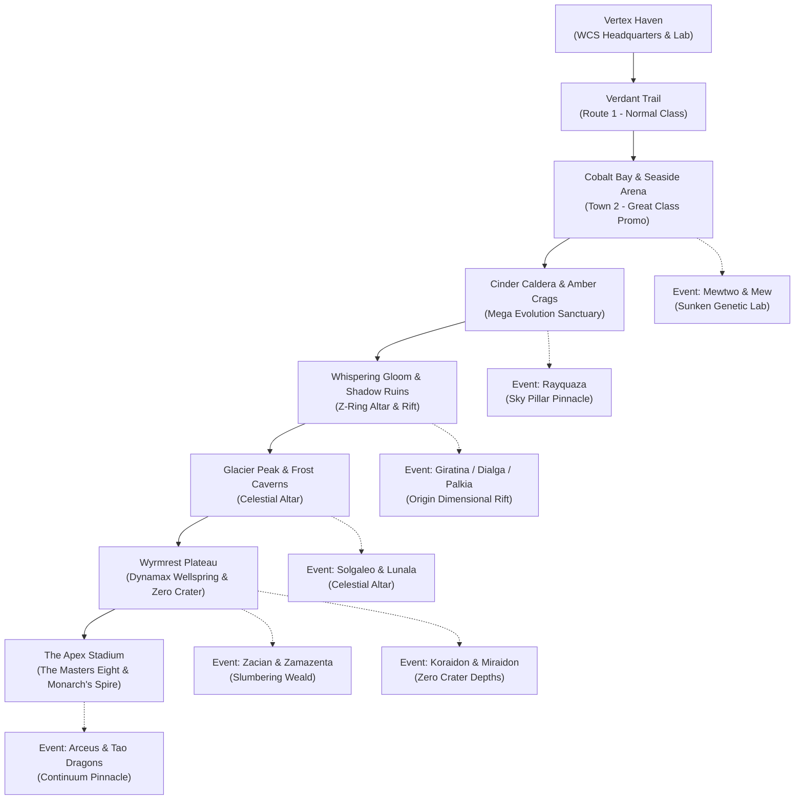

# 👑 Pokémon Emerald: Journeys — Master Walkthrough & Secret Storyline Guide

> **Confidential Player Guide**: This exclusive guide contains the complete roadmap to complete the game within 5 hours, conquer every World Coronation Series rank tier, defeat the Masters Eight, and trigger every single Legendary Pokémon catch event across all generations.

---

## 🎮 1. Quick Start: How to Play (Laptop & Mobile)

This game runs entirely inside modern web browsers with **no emulators required**. It is built with zero-dependency HTML5 Canvas, modern JavaScript (ES Modules), CSS3, and the Web Audio API.

### Starting the Game Server
In your terminal inside `/Users/anikhshanly/Downloads/game`:
```bash
python3 -m http.server 8000
```
- **On Laptop**: Open `http://localhost:8000` in Google Chrome, Safari, Firefox, or Edge.
- **On Mobile**: Connect your phone to the same Wi-Fi and open `http://<your-laptop-ip>:8000` (or host it on GitHub Pages / Vercel with 1 click).

### Controls Mapping

| Action | Laptop / Keyboard | Mobile / Touch Screen |
| :--- | :--- | :--- |
| **Move / Walk** | Arrow Keys or `W`, `A`, `S`, `D` | On-Screen Tactile Emerald D-Pad |
| **Run / Sprint** | Hold `Shift` | Tap **[B]** Button (Toggles Run mode) |
| **Interact / Confirm (A)** | `Z`, `Space`, or `Enter` | Tap **[A]** Circle Button |
| **Cancel / Back (B)** | `X`, `Escape`, or `Backspace` | Tap **[B]** Circle Button |
| **Trainer Menu (Rotom Phone)** | `C`, `M`, or `Tab` | Tap **[MENU]** Center Pill |
| **Game Speed (1x / 2x / 3x)** | Number keys `1`, `2`, `3` | Tap **[TURBO]** Center Pill |

---

## 🗺️ 2. The Astraea Region: Map & Portal Network

The Astraea continent is divided into 7 interconnected regional zones:



---

## ⏱️ 3. The 5-Hour Continuous Speedrun Timeline

By toggling **2x or 3x Speed** (Turbo) and taking advantage of the built-in **Modern Exp Share**, you can comfortably clear the story in under 5 hours.

```
00:00 - 01:00 ── Hour 1: Starter Selection & Normal Class Sweep (Rank 10,000 -> 1,001)
01:00 - 02:00 ── Hour 2: Great Class Promotion & Mega Evolution Awakening (Rank 1,000 -> 101)
02:00 - 03:00 ── Hour 3: Ultra Class Promotion, Z-Ring & Dynamax Band (Rank 100 -> 9)
03:00 - 04:15 ── Hour 4: The Masters Eight Tournament (Ranks 8 to 2)
04:15 - 05:00 ── Hour 5: The Grand Monarch Championship vs Leon & Legendary Events
```

---

## 🥊 4. Complete World Coronation Series (WCS) Walkthrough

### 📍 Normal Class (Rank #10,000 to #1,001)
1. **Starting Step**: Register at the WCS Bureau in Vertex Haven with Rotom Drone. Choose your starter from any of the 9 generations.
2. **Match 1 — Oliver (Rank #9,240)**:
   - **Location**: Verdant Trail (x: 6, y: 10)
   - **Team**: Rookidee (Lv.8), Shinx (Lv.9)
   - **Strategy**: Your starter will easily defeat both with standard STAB moves.
   - **Reward**: Rank climbs to **#7,740**.
3. **Match 2 — Visquez (Rank #5,120)**:
   - **Location**: Verdant Trail Outpost (x: 13, y: 5)
   - **Team**: Pikachu (Lv.16), Corvisquire (Lv.17)
   - **Strategy**: Use Ground or Rock moves. Catch a Shinx or Gible along the path.
   - **Reward**: Rank climbs to **#2,520**.
4. **Match 3 — Tony (Rank #1,850)**:
   - **Location**: Cobalt Bay Harbor (x: 8, y: 12)
   - **Team**: Croconaw (Lv.23), Larvitar (Lv.24)
   - **Strategy**: Water/Grass moves against Larvitar; Electric/Grass against Croconaw.
   - **Reward**: Rank reaches **#1,000** (Unlocks Great Class!).

---

### 📍 Great Class (Rank #1,000 to #101)
1. **Promotion Match — Bea (Rank #999)**:
   - **Location**: Cobalt Bay Seaside Arena (x: 15, y: 4)
   - **Team**: Machamp (Lv.29, G-Max), Quaquaval (Lv.30)
   - **Strategy**: Bea's Machamp will Gigantamax! Use Flying or Psychic moves (Corvisquire or Ralts/Gardevoir). Keep your HP above 50%.
   - **Reward**: Rank drops to **#649**.
2. **Match 4 — Korrina (Rank #480)**:
   - **Location**: Cinder Caldera Sanctuary (x: 4, y: 4)
   - **Team**: Lucario (Lv.36, Mega Lucario), Blaziken (Lv.35)
   - **Strategy**: Korrina will activate Mega Evolution on Lucario! Counter with Fire/Fighting/Ground moves.
   - **Reward**: Unlocks the **MEGA BRACELET**! Rank climbs to **#220**.
3. **Match 5 — Volkner (Rank #180)**:
   - **Location**: Amber Crags (x: 12, y: 9)
   - **Team**: Luxray (Lv.42), Metagross (Lv.43)
   - **Strategy**: Ground and Fire moves destroy Volkner's setup.
   - **Reward**: Rank drops to **#100** (Unlocks Ultra Class!).

---

### 📍 Ultra Class (Rank #100 to #9)
1. **Promotion Match — Raihan (Rank #99)**:
   - **Location**: Wyrmrest Plateau Wellspring (x: 10, y: 8)
   - **Team**: Dragonite (Lv.48), Garchomp (Lv.49), Charizard (Lv.50, G-Max)
   - **Strategy**: Raihan opens with Dragon powerhouses. Ice Beam or Fairy moves (Moonblast) counter Dragonite and Garchomp. Water/Rock takes down Charizard.
   - **Reward**: Unlocks the **DYNAMAX BAND**! Rank drops to **#54**.
2. **Match 6 — Paul (Rank #45)**:
   - **Location**: Whispering Gloom Monoliths (x: 10, y: 9)
   - **Team**: Gengar (Lv.54, G-Max), Metagross (Lv.55), Tyranitar (Lv.55, Mega)
   - **Strategy**: Ghost/Dark moves against Gengar and Metagross; Fighting/Water against Tyranitar.
   - **Reward**: Unlocks the **Z-RING & Z-CRYSTALS**! Rank drops to **#20**.
3. **Match 7 — Marnie (Rank #15)**:
   - **Location**: Glacier Peak Gate (x: 10, y: 8)
   - **Team**: Tinkaton (Lv.58), Baxcalibur (Lv.59), Gengar (Lv.60, G-Max)
   - **Strategy**: Fire moves against Tinkaton; Fighting/Steel against Baxcalibur.
   - **Reward**: Rank reaches **#8** (Masters Eight Tournament Qualified!).

---

### 🏆 The Masters Eight Tournament (Apex Stadium)

Head north from Wyrmrest Plateau into **The Apex Stadium**. Step into the grand ring to face the eight strongest trainers in the Pokémon world!

| Match | Opponent | Key Pokémon & Gimmicks | Recommended Counters |
| :--- | :--- | :--- | :--- |
| **Round 1 (Rank 8)** | **Alain** | Chesnaught (Lv.65), Tyranitar (Lv.65), **Mega Charizard X** (Lv.67) | Ground / Dragon / Rock (Earthquake, Stone Edge) |
| **Round 2 (Rank 7)** | **Champion Iris** | Dragonite (Lv.67), Garchomp (Lv.68), **Haxorus** (Lv.69) | Ice Beam (x4 vs Dragonite/Garchomp), Fairy (Moonblast) |
| **Round 3 (Rank 6)** | **Grand Champion Diantha**| Aurorus (Lv.70), Goodra (Lv.70), **Mega Gardevoir** (Lv.72) | Steel (Iron Head / Flash Cannon), Ghost (Shadow Ball) |
| **Round 4 (Rank 5)** | **Champion Lance** | **G-Max Red Gyarados** (Lv.72), Aerodactyl (Lv.72), Dragonite (Lv.74) | Electric (Thunderbolt x4 vs Gyarados!), Ice Beam |
| **Round 5 (Rank 4)** | **Champion Steven Stone** | Aggron (Lv.75), Cradily (Lv.75), **Mega Metagross** (Lv.77) | Fire (Flamethrower), Ground (Earthquake) |
| **Round 6 (Rank 3)** | **Champion Cynthia** | Spiritomb (Lv.78), Milotic (Lv.78), **Mega Lucario** (Lv.79), **Garchomp** (Lv.80) | Fairy for Spiritomb, Electric for Milotic, Ice Beam for Garchomp |
| **Round 7 (Rank 2)** | **Ash Ketchum** | Dragonite (Lv.82), **G-Max Gengar** (Lv.82), **Mega Lucario** (Lv.83), **10,000,000 Volt Pikachu** (Lv.85) | Ground / Psychic / Fire. Dynamax on turn 1 to survive Pikachu's Z-Move! |
| **FINAL CROWN MATCH** | **Monarch Leon** | Aegislash (Lv.86), Dragapult (Lv.86), Rillaboom (Lv.87), Cinderace (Lv.87), Inteleon (Lv.87), **Gigantamax Charizard** (Lv.90) | Use your own Mega Evolution and Z-Move! Counter G-Max Wildfire with Rock Slide / Max Rockfall |

---

## 🌌 5. Legendary Pokémon Catching Events Guide

All 8 Legendary Portals become active as your WCS rank climbs:

### 1. Rayquaza (Emerald Dragon God)
- **Portal**: Amber Crags — Sky Pillar Pinnacle (x: 17, y: 1)
- **Requirement**: Great Class (Rank <= 1,000)
- **Boss**: Level 70 Mega Rayquaza (Dragon / Flying)
- **Catch Strategy**: Rayquaza uses Dragon Ascent and Extreme Speed. Weaken with Ice moves to 10% HP, then throw an Ultra Ball.
- **Reward**: Catches Rayquaza + Unlocks **Rayquazite**.

### 2. Mewtwo & Mew (The Genetic Apex)
- **Portal**: Cobalt Bay — Sunken Genetic Lab (x: 2, y: 3)
- **Requirement**: Ultra Class (Rank <= 100)
- **Boss**: Level 70 Mega Mewtwo Y (Psychic) + Level 60 Mew
- **Catch Strategy**: High Sp. Atk. Use Dark moves (Crunch, Dark Pulse) to safely lower HP. Ultra Ball or Master Ball.
- **Reward**: Catches Mewtwo & Mew + **Mewtwonite Y**.

### 3. Creation Trio & Arceus (Origin Rift)
- **Portal**: Whispering Gloom — Dimensional Rift (x: 2, y: 2)
- **Requirement**: Ultra Class (Rank <= 50)
- **Boss**: Level 75 Giratina (Origin Form), Dialga, Palkia, and Level 80 Arceus
- **Catch Strategy**: Arceus possesses Judgement and Extreme Speed. Put to Sleep or Paralysis, throw Ultra Balls or Master Balls.
- **Reward**: Catches the Creation Trio and Arceus!

### 4. Primal Kyogre & Primal Groudon
- **Portal**: Cobalt Bay Abyssal Cave / Cinder Caldera Core
- **Requirement**: Great Class (Rank <= 500)
- **Boss**: Level 70 Primal Kyogre & Level 70 Primal Groudon
- **Catch Strategy**: Heavy Rain and Desolate Sun cancel each other out. Bring Grass and Water counters.
- **Reward**: Catches Kyogre & Groudon + **Blue Orb & Red Orb**.

### 5. Zacian & Zamazenta (Heroes of Galar)
- **Portal**: Wyrmrest Plateau — Slumbering Weald Shrine (x: 2, y: 2)
- **Requirement**: Ultra Class (Rank <= 20)
- **Boss**: Level 72 Crowned Zacian (Behemoth Blade) & Crowned Zamazenta
- **Catch Strategy**: Fairy/Steel and Fighting/Steel. Earthquake and Fire Blast are top counters.
- **Reward**: Catches Zacian & Zamazenta + **Rusted Sword & Rusted Shield**.

### 6. Solgaleo & Lunala (Celestial Altar)
- **Portal**: Glacier Peak Summit (x: 9, y: 2)
- **Requirement**: Ultra Class (Rank <= 10)
- **Boss**: Level 72 Solgaleo (Sunsteel Strike) & Level 72 Lunala (Moongeist Beam)
- **Catch Strategy**: Dark and Ghost moves deal x4 to Lunala; Ground/Fire deals x2 to Solgaleo.
- **Reward**: Catches Solgaleo & Lunala + **Solganium Z & Lunalium Z**.

### 7. Koraidon & Miraidon (Paradox Singularity)
- **Portal**: Wyrmrest Plateau — Zero Crater Depths (x: 16, y: 2)
- **Requirement**: Master Class (Rank <= 8)
- **Boss**: Level 75 Apex Koraidon & Ultimate Miraidon
- **Catch Strategy**: High speed collision attacks. Fairy moves deal x4 to Koraidon; Ground deals x2 to Miraidon.
- **Reward**: Catches Koraidon & Miraidon + **Paradox Booster Core**.

### 8. The Legendary Multiverse (Post-Game)
- **Portal**: The Apex Stadium Pinnacle (x: 9, y: 0)
- **Requirement**: World Monarch (Rank #1)
- **Boss**: Level 80 Reshiram, Zekrom, Xerneas, Yveltal, and Divine Arceus
- **Catch Strategy**: Free Master Balls rewarded after defeating Leon ensure 100% catch rate!

---

## ⚡ 6. Developer Console & Secret Codes

Press **[MENU]** -> **[Dev Cheats]** at any time to enter these cheat codes:

| Code | Effect |
| :--- | :--- |
| `/godmode` or `/level100` | Instantly sets your entire party to **Level 100** with **999 Max HP** and 500 stats! |
| `/rankup` | Cuts your WCS rank in half immediately (e.g. #10,000 -> #5,000 -> #1,000 -> #100 -> #8). |
| `/unlockgimmicks` | Instantly unlocks the **Mega Bracelet**, **Z-Ring**, and **Dynamax Band**! |
| `/giveall` | Grants **50 Master Balls**, 99 Ultra Balls, and **$999,999 Poké Dollars**! |

---

## 📺 8. TV Anime Realism & Attack Animations Engine

The game incorporates authentic **Pokémon Journeys TV anime aesthetics**:

### Realistic Anime Visuals & Dynamic Arena
- **Live Animated Pokémon Sprites**: Uses high-resolution animated Showdown GIFs with idle breathing, attacks, and idle animations.
- **3D Perspective Battle Arena**: Features a stadium turf with chalk boundary lines, stadium floodlight cones, and floating battle pedestals with soft drop shadows beneath each Pokémon.
- **Floating Rotom Broadcast Drone**: Overhead drone camera tracking the World Coronation Series match live with pulsing recording indicator.
- **Anime Action Banners**: When an attack is launched, a dramatic high-speed anime banner flies across the screen announcing the move and elemental category.
- **Physical Dash & Recoil**: The attacking Pokémon lunges forward into the arena; the target reels backward with impact flashes and directional camera shake.

### Anime Attack Visual Effects
- **⚡ Electric**: Branching multi-forked lightning bolts and plasma spheres. Ash's *10,000,000 Volt Thunderbolt* unleashes 7 simultaneous rainbow-colored lightning pillars!
- **🔥 Fire**: Roaring torrents of spiral flames, burning embers, and the legendary *Fire Blast* kanji (大) blazing across the stadium.
- **🌊 Water**: High-pressure swirling hydro vortices and water shurikens with splashing ripple rings.
- **🍃 Grass**: Razor-sharp emerald energy crescent slashes and tornadoes of glowing green leaf petals.
- **❄️ Ice**: Freezing cyan beams that encase the opponent in a crystalline iceberg before shattering.
- **🐉 Dragon**: Twin glowing dragon claw slashes and cosmic meteors raining down.
- **🔮 Ghost & Dark**: Supermassive vortex of antimatter shadow spheres and dark tendrils.
- **🪨 Ground & Rock**: Giant jagged stone pillars erupting from the arena floor with heavy screen tremors.
- **🧬 Mega Evolution**: 3D iridescent rotating DNA helix symbol with surging rainbow aura rings.
- **☁️ Dynamax / Gigantamax**: Red dynamax energy geysers erupting from the floor with 3 swirling crimson storm clouds and red lightning.

---

## 🏥 9. Faint & Nearest Pokémon Center Recovery System

When all Pokémon in your party faint in battle:
1. **Dramatic Anime Blackout**: Screen fades to black with a heartbeat sound and the iconic message: *"Ash is out of usable Pokémon... Ash blacked out!"*
2. **Nearest Center Respawn**: The game determines your location and immediately transports you to the closest medical facility:
   - **Vertex Haven / Verdant Trail** ➔ *Vertex Haven Central Center*
   - **Cobalt Bay** ➔ *Cobalt Bay Harbor Center*
   - **Cinder Caldera / Whispering Gloom** ➔ *Caldera Recovery Station*
   - **Glacier Peak** ➔ *Frost Peak Shelter*
   - **Wyrmrest Plateau / Apex Stadium** ➔ *The Apex Stadium Medical Center*
3. **100% Full Health Restoration**:
   - All Pokémon are fully revived and restored to **100% Max HP**.
   - All status ailments (burn, paralysis, freeze) and gimmick exhaustion are cleared.
   - The iconic healing jingle plays as Nurse Joy greets you:
     > *"You're safe now! We treated your exhausted Pokémon and brought them back to full vitality! Take heart, trainer, and rise again!"*

The game features an authentic Pokémon Emerald **Multi-Slot Save System**:

### How to Save Your Game
1. **Top Bar Quick Save**: Click or tap the green **[💾 Save]** button at the top header bar at any time.
2. **Trainer Menu Save**: Open the Menu (`C`, `M`, or tap `MENU`) and select **[💾 Save Progress]**.
3. **Keyboard Shortcut**: Press `P` in the overworld to open the Save Screen immediately.
4. **Auto-Save**: The game automatically creates an auto-save whenever:
   - You win a battle (Wild, WCS Challenger, or Legendary).
   - You catch a Pokémon.
   - You transition between zones or routes.
   - A subtle toast indicator (`💾 Auto-Saved ✓`) appears at the top right.

### Multi-Slot Storage (Slots 1, 2, and 3)
- Manage up to **3 separate save slots**.
- Each slot displays:
  - Timestamp and Date
  - Current WCS Rank & Class Tier
  - Real Playtime elapsed (`HH:MM:SS`)
  - Location / Zone name
  - Party Pokémon preview with sprites and levels

### Backup, Export & Cross-Device Sync (Laptop ↔ Phone)
- **Download Save File**: Click **[Download Save File (.json)]** to save your progress directly to your device as a JSON file.
- **Restore / Upload Save File**: Click **[Upload / Restore File]** to select any previously saved `.json` file and resume your adventure on any other phone, tablet, or laptop browser!
